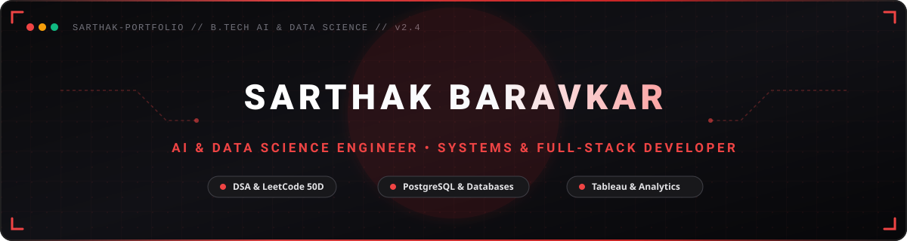
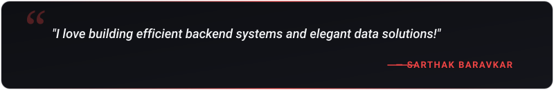

  

  

  &nbsp;&nbsp;
  &nbsp;&nbsp;
  &nbsp;&nbsp;
  

  

<h2 align="center">🔴 About Me</h2>

  

  

  Hey! I'm <b>Sarthak Baravkar</b>, an undergraduate <b>AI & Data Science engineering student</b>. 
  I am passionate about data structures, algorithms, and full-stack development, and I enjoy building efficient database architectures and interactive data visualizations.

  &nbsp;&nbsp;
  &nbsp;&nbsp;
  

  💬 <b>Let's Discuss:</b> Python, Java, C++, C, SQL, PostgreSQL, MongoDB, & Data Visualization. 
  ⚡ <b>Philosophy:</b> <i>"I love building efficient backend systems and elegant data solutions!"</i>

<table width="100%" border="0" align="center">
  <tr>
    <td width="50%" align="center" style="padding: 16px;">
      <h4>🔭 Flagship Project</h4>
      
<b>skillByte</b> Hybrid Quiz &amp; Live Coding Platform (Judge0 API)

      

        
      

    </td>
    <td width="50%" align="center" style="padding: 16px;">
      <h4>🗄️ Relational Database</h4>
      
<b>Celestial Bodies Database</b> Relational Schema Designed in PostgreSQL

      

        
      

    </td>
  </tr>
  <tr>
    <td width="50%" align="center" style="padding: 16px;">
      <h4>📊 Data Analytics Capstone</h4>
      
<b>Global AI Adoption in Education</b> Interactive Tableau Dashboards &amp; Geographical Insights

      

        
      

    </td>
    <td width="50%" align="center" style="padding: 16px;">
      <h4>🎓 Web Portal Concept</h4>
      
<b>SmartPredict</b> College Admission Assistant &amp; CET Percentile Aggregator

      

        
      

    </td>
  </tr>
</table>

<h2 align="center">🔴 Featured Project Spotlight</h2>

<table width="100%" border="0" align="center">
  <tr>
    <td align="center" style="padding: 24px;">
      <h3>🔬 skillByte — Live Coding Evaluator &amp; Assessment Engine</h3>
      
<i>A hybrid quiz platform combining multiple-choice theoretical assessments with a live coding evaluation engine powered by the Judge0 API.</i>

      

        &nbsp;
        &nbsp;
        
      

      

        
      

    </td>
  </tr>
</table>

<h2 align="center">🧩 LeetCode Problem Solving</h2>

<i>Live real-time tracker of coding challenges &amp; algorithmic problem-solving milestones.</i>

  

  &nbsp;&nbsp;
  &nbsp;&nbsp;
  

<h2 align="center">🛠️ Tech Stack &amp; Skills</h2>

<b>Core Programming Languages</b>

  

<b>Databases &amp; Big Data</b>

  

  &nbsp;&nbsp;
  &nbsp;&nbsp;
  

<b>Developer Tools, Platforms &amp; Design</b>

  

  

<h2 align="center">📊 GitHub Analytics &amp; Activity</h2>

  &nbsp;&nbsp;
  

  

  

<h2 align="center">🏎️ Continuous Drive &amp; Momentum</h2>

  

<h2 align="center">📬 Let's Connect &amp; Collaborate</h2>

<i>Whether you want to discuss system architecture, algorithmic problem-solving, or explore open-source collaboration — my inbox is always open!</i>

<table border="0" align="center">
  <tr>
    <td align="center" width="180" style="padding: 16px;">
      <a href="https://www.linkedin.com/in/sarthak-baravkar-592b03384/" target="_blank">
          
        
      </a> 
      <b>Professional Network</b>
    </td>
    <td align="center" width="180" style="padding: 16px;">
      <a href="mailto:sarthakbaravkar881@gmail.com">
          
        
      </a> 
      <b>Direct Collaboration</b>
    </td>
    <td align="center" width="180" style="padding: 16px;">
      <a href="https://github.com/sarthakbaravkar881-collab" target="_blank">
          
        
      </a> 
      <b>Open Source</b>
    </td>
    <td align="center" width="180" style="padding: 16px;">
      <a href="https://leetcode.com/sarthakbaravkar881" target="_blank">
          
        
      </a> 
      <b>Algorithmic Practice</b>
    </td>
  </tr>
</table>

  

